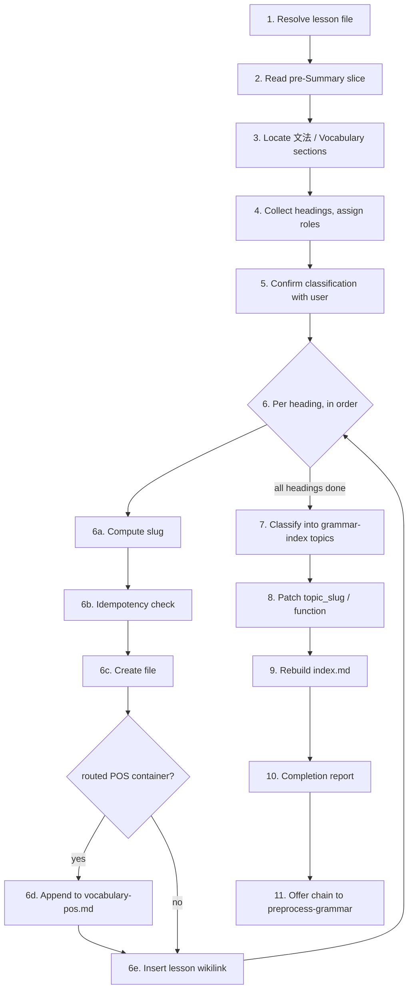

# Extract Grammar Skill

Load before starting:
- `.cowork/skills/lesson-to-web/_conventions.md`
- `.cowork/skills/_heading-roles.md`
- `.cowork/skills/lesson-to-web/_slug-rules.md` (needed at Step 6a)
- `.cowork/skills/lesson-to-web/_grammar-templates.md` (needed at Step 6c)

## Pipeline



---

## Step 1 — Resolve lesson file

**Trigger:** user says "extract grammar from `<code>`"

**Do:**
1. Level = digit immediately after `UN` (`UN5GL14` → `N5`).
2. Search `JPLessons/Udemy/N<level>/Grammar/` for a file named exactly `<code>.md` or starting with `<code>-`.

**Edge cases:**
- Zero or multiple matches → stop, ask user.
- Prefix collision (`UN4GL1` matching `UN4GL14.md`) is not a match — reject it.

**Output:** resolved lesson file path.

---

## Step 2 — Read pre-Summary slice

**Do:**
```bash
awk '/^# Summary[[:space:]]*$/{exit} {print}' "$LESSON_FILE"
```

**Edge cases:**
- No `# Summary` line found (slice == whole file) → stop, ask user. Never silently process the full file.

**Output:** pre-Summary slice, the only input to every later step.

---

## Step 3 — Locate target sections

| Section | Match | If wrong level | If absent |
|---|---|---|---|
| `# 文法` | heading level 1, until next same-level heading | ask user to confirm | log `[SKIP] <code>: no 文法 section found` |
| `# Vocabulary` | heading level 1, until next same-level heading | ask user to confirm | skip silently (optional) |

A section present but empty (no content under the heading) counts as absent — same rules apply, and it's excluded from the Step 5 table.

---

## Step 4 — Collect headings, assign roles

**Do:**
1. Collect every heading from both sections into a tree: `heading text`, `body`, `parent`, `source` (文法/Vocabulary).
2. Assign each a role — **scaffolding / container / point** — per `_heading-roles.md`.
3. Fold scaffolding bodies into the nearest non-scaffolding ancestor. Scaffolding is never a classification candidate.

**Output:** heading tree with roles.

---

## Step 5 — Confirm classification with user

**Do:**
1. For each candidate (container/point), compute proposed slug (Step 6a) and, for Vocabulary items, a subdir suggestion. A generic sub-heading nested under a more specific parent container (e.g. a bare `Verbs` or `Structure` heading) should have its slug qualified using context from the parent heading, not left as the bare generic word alone.
2. Print the table below, wait for user confirm/override.

**Format — print this table and wait for user input:**

```
Headings found in <lesson-code>:

  [文法]
  1. ## Numbers                [container: no prose, groups 2–3]                        slug: numbers
  2.   #### Only numbers       [grammar: reference table 0–万]                          slug: only-numbers
  3.   #### 同じ - same        [grammar: has Structure + Examples]                      slug: ji-same

  [Vocabulary]
  4. ## こんな, そんな, あんな  [grammar: 3 example lines]        → subdir: Adjectives?  slug: konna-sonna-anna
  5. ### 出来る（できる)       [grammar: 2 structures + examples] → subdir: Verbs?      slug: dekiru

Confirm or override each role (grammar / container / skip).
Slugs are the proposed filenames (permanent URLs) — to change one, type: slug <n> <new-slug>
For Vocabulary items, confirm or change the suggested subdir.
If the suggested subdir doesn't fit, type: new:<dirname> or other
```

The bracketed role uses the user-facing classification vocabulary: a `_heading-roles.md` **point** is shown as `[grammar: …]`, a **container** as `[container: …]`. If the user believes a listed candidate is actually scaffolding (or vice versa), that is a signal to extend the scaffolding label list in `_heading-roles.md` — with user confirmation — before proceeding.

**Subdir heuristic (Vocabulary only):**

| Content | Suggested subdir |
|---|---|
| verb conjugation/usage | Verbs |
| adjective forms/usage | Adjectives |
| nouns/expressions/pronouns/set phrases | Nouns |
| unclear/mixed | Nouns (flag ambiguity) |
| user types `new:<dirname>` | create that subdir |
| user types `other` | `vocabulary/Other/` |

**Routing table (carries forward through Steps 6–9):**

| Classification | Source | Destination |
|---|---|---|
| grammar | 文法 | `grammar-index/grammar/<slug>.md` — normal flow |
| grammar | Vocabulary | `grammar-index/grammar/vocabulary/<subdir>/<slug>.md` — Step 6c-ii |
| container | Vocabulary, heading normalized to exactly Verbs/Nouns/Adjectives, all children Vocabulary-grammar | Step 6d (POS-consolidated) |
| container | anything else (mixed Vocabulary heading, or any 文法 container) | Step 6c container template → `grammar-index/<slug>.md` (root, not `grammar-index/grammar/`) |
| skip | any | no file, no wikilink |

**skip** — do not extract. Used for pure vocabulary lists or headings that are not grammar patterns.

Process headings **one at a time**: 6a→6e fully before starting the next heading. Don't batch across headings.

---

## Step 6 — Per heading

### 6a. Compute slug
Use a user-provided override verbatim if given in Step 5. Otherwise apply the algorithm in `_slug-rules.md`.

### 6b. Idempotency check

**Do:**
1. Check the target path (per Step 5's routing table) for an existing file.
2. Also check for the same `pattern:` text under a *different* slug:
   ```bash
   grep -rlF 'pattern: <exact heading text>' grammar-index/grammar/
   ```
   (confirm `lesson:` matches too)

**Edge cases:**
- Routed POS containers (6d) are exempt from the `pattern:` grep — 6d has its own link-target dedup.
- Target exists (by either check) → ask user: `1 Skip / 2 Overwrite / 3 Rename`. Wait.

### 6c. Create the file
Templates: see `_grammar-templates.md` (grammar-point / container / vocabulary-leaf).

**Field rules:**

| Field | Rule |
|---|---|
| `lesson` | lesson code |
| `pattern` | exact heading text, unchanged |
| `topic_slug` | `""` (filled Step 8) |
| `function` | `[]` (filled Step 8; grammar-point files only) |
| `level` | from lesson path |
| `proofread` | always `false` |
| gloss line | one-line English gloss derived from body |
| `## Structure` | formation rule from body (or derived from examples); copy reference tables verbatim above the rule |
| `## Examples` | all example sentences, one bullet each (`_conventions.md` "Examples content format"); always present, empty if none |
| `## Use Cases` | English explanation of this pattern's own usage; omit if gloss covers it; never put comparisons to a *different* pattern here |
| `## Notes` | omit on creation **unless** body has a nuance/contrast table against a different pattern with no standalone file yet — that goes here verbatim (only thing Notes ever gets on creation) |

**Overwrite preservation:** if user chose Overwrite and the existing file has `register:`/`confused_with:` frontmatter or `## Register`/`## Often confused with` sections, carry them into the new file unchanged: place `register:`/`confused_with:` in the frontmatter after `level`, before `proofread`; place `## Register`/`## Often confused with` in the body in their `_conventions.md` section-order position.

### 6c-ii. Vocabulary leaf files (grammar heading sourced from Vocabulary)

**Do:**
1. Judge single sense vs. 2+ distinct senses from the body (same test as `structure-grammar.md`, scoped to word senses — not just different grammatical forms of the same meaning). Existing source structure (a `### Use cases` or `### Meaning` list with 2+ distinct entries) is a strong signal but not authoritative.
2. Propose shape to user, wait for confirmation:
   ```
   Vocabulary word: <heading> (<slug>)
   Content summary: <...>
   1. Single sense — flat
   2. <N> distinct senses — numbered
   3. Skip structuring — flat fallback
   ```
   A user override of sense count or names is used verbatim.
3. Populate per `_conventions.md` "## Structure format" (flat or numbered template).
4. Strip only the `#w`/`#wc`/`#wp` tag prefix, keep the rest.
5. Sort into **Structure** (prose: POS, reading, transitivity, collocations) / **Examples** (bulleted) — reorganize, don't paste verbatim.
6. Never add `## Use Cases` / `## Notes` / `## Register` / `## Often confused with`.
7. Not topic-classified in Step 7 — subdir is the classification.

Output path: `grammar-index/grammar/vocabulary/<subdir>/<slug>.md`. Create the subdir if it does not exist.

### 6d. Vocabulary POS container append (routed containers only)

Runs after leaf files exist, before 6e.

**Do:**
1. Target: `grammar-index/vocabulary-<pos>.md`. Create from template in `_grammar-templates.md` if missing — no theming decision needed for a first entry, skip straight to item 3.
2. Dedup: skip a leaf if its link path already appears anywhere in the file (any theme, or ungrouped) — search by path.
3. Propose placement per new entry — join existing theme / start new theme (2+ entries share a genuine topic) / stay ungrouped. Wait for confirmation; override used verbatim. Never force a theme.
   ```
   Vocabulary POS entry: <label> (<slug>)
   grammar-index/vocabulary-<pos>.md — existing themes: <theme list, or "none yet">
   Proposed placement: 1. Join theme "<theme>"  2. New theme "<name>"  3. Stay ungrouped
   Confirm or override (theme name / ungrouped):
   ```
4. Write: themed placement — insert the bullet under the matching `### <Theme>` heading, creating the heading immediately after `## Sub-topics` if this is the theme's first appearance, or immediately after the last existing themed group if joining one already created. Ungrouped placement — append flat bullets at the end of `## Sub-topics` content, after all themed groups.

Runs regardless of whether 6b resulted in Created or Skip for the leaf — item 2's dedup is the only gate needed. (Skip is the *common* case here: recurring words like できる get re-extracted from many lessons.)

### 6e. Insert lesson wikilink

**Do:**
1. Insert `→ [[grammar-index/grammar/<slug>]]` on the line immediately after the heading, before existing body.
2. Use Python: slice at `# Summary` first, insert via `re.subn`, `[WARN]` if count is 0. Never modify `<!--ID:-->` lines. Collect all `[WARN]` lines and include them in the Step 10 completion report.
3. Duplicate heading text in the file → narrow substitution to the correct occurrence's line range (from Step 4's tree), not first-match.

**Gating table:**

| Link tier | Inserted when | Dedup check |
|---|---|---|
| Normal grammar/container | file Created in 6c | `[[grammar/<slug>]]` already under heading |
| Container-level (routed POS) | leaf(s) processed by 6d | `[[vocabulary-<pos>]]` already under heading |
| Per-child (routed POS) | always, regardless of 6b outcome | `[[grammar/vocabulary/<subdir>/<slug>]]` already under *that child's own* heading |

---

## Step 7 — Classify into grammar-index topics

Only files **Created** in 6c (grammar point + container). Vocabulary leaf and POS-consolidated files are excluded — their path is their classification.

**Do:**
1. `ls grammar-index/*.md | grep -v index.md`, read each `> description`. No topic files → empty taxonomy, proceed.
2. Plan all classifications before writing. Bias toward existing files; up to 3 topics per point; new file only if nothing fits and the name is reusable.
3. Per (point, topic) pair: dedup, insert entry before `## See also` (or append to `## Entries`), create new topic file from template if needed.
4. Bidirectional `## See also`: for every topic pair sharing a point, make the link symmetric both ways; dedup; also add the reverse link when a new topic file is created with a `## See also` entry. Format: `- [<Topic Title>](/JapaneseNotes/grammar-index/<slug>) — <short reason>`, where `<Topic Title>` is the target topic file's `# heading`; write a short phrase describing why the topics are related — do not copy the filename verbatim.
5. **Container membership sync.** Runs once, after items 1–4 above have finished writing for the *entire* run (all points/containers processed, all topic files patched) — not interleaved per-file mid-run. This matters because a container can be newly created earlier in this same Step 7 pass; the membership check below must see that container as it exists at the end of the run, not a stale snapshot from before Step 7 started.

   For each grammar **point** file (never container files) classified into a topic during this run: check whether that topic's `## Entries` also includes a container file (a file with `## Sub-topics`). If so, and the point's slug is not already present in that container's `## Sub-topics` list, prompt (one prompt per distinct (point, container) pair, in topic order):
   ```
   <point-name> (<slug>) was classified into topic "<Topic Title>", which also contains
   container "<Container Name>" (<container-slug>).
   Add <point-name> to <Container Name>'s Sub-topics? (yes / no)
   ```
   - **yes** → append `- [<pattern>](/JapaneseNotes/grammar-index/grammar/<slug>) · <level>` to the container's `## Sub-topics` list, in the same bullet format as the Step 6c container template; dedup by link path first. `<pattern>` and `<level>` are read from the target point file's own frontmatter (`pattern:` / `level:` fields) — the same field-source convention already used by every other bullet-writing step in this file (e.g. Step 6d's `## Sub-topics` bullets).
   - **no** → skip, no file changes.

   A point may be classified into multiple topics (up to 3) and a topic may contain more than one container — prompt once per distinct (point, container) pair found.

---

## Step 8 — Patch topic_slug / function

**Do:**
1. `topic_slug` → YAML list, even for one value.
2. `function` → 0–2 values from `_conventions.md`'s controlled vocabulary. Empty is fine. New value needed → stop, propose adding it to `_conventions.md`, wait for confirmation.

After this step, both fields are immutable.

---

## Step 9 — Rebuild index.md

Trigger: only if a new topic file was created in Step 7. Regenerate from current `grammar-index/` state, grouped into: Verbs / Adjectives / Particles / Patterns / Forms & Counters / Other (omit empty groups). Format in `_grammar-templates.md`.

---

## Step 10 — Completion report

```
UN5GL14 — 6 grammar points processed
  [文法]
  Created:  grammar-index/grammar/point-1.md → requests-commands
  Skipped:  grammar-index/grammar/point-3.md (user chose skip)
  [Vocabulary]
  Created:  grammar-index/grammar/vocabulary/Verbs/dekiru.md
  Appended: grammar-index/vocabulary-verbs.md ← dekiru-can (ungrouped)
```

---

## Step 11 — Offer chain

`N` = grammar point + container files created this run only (never vocabulary/POS files).

```
Run preprocess-grammar on the N newly created files? (yes / no / all)
```
- **yes** → load `preprocess-grammar.md` with the created paths.
- **no** → end.
- **all** → load preprocess-grammar in "all" mode (chains through review→structure→register-confusability→see-also, no prompts).
